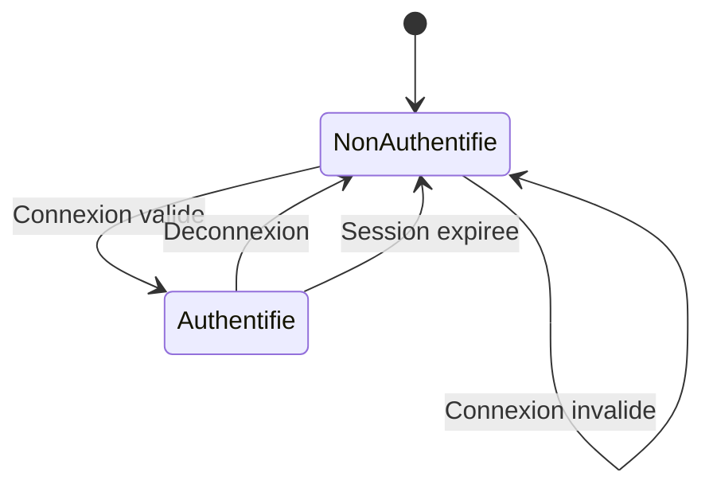
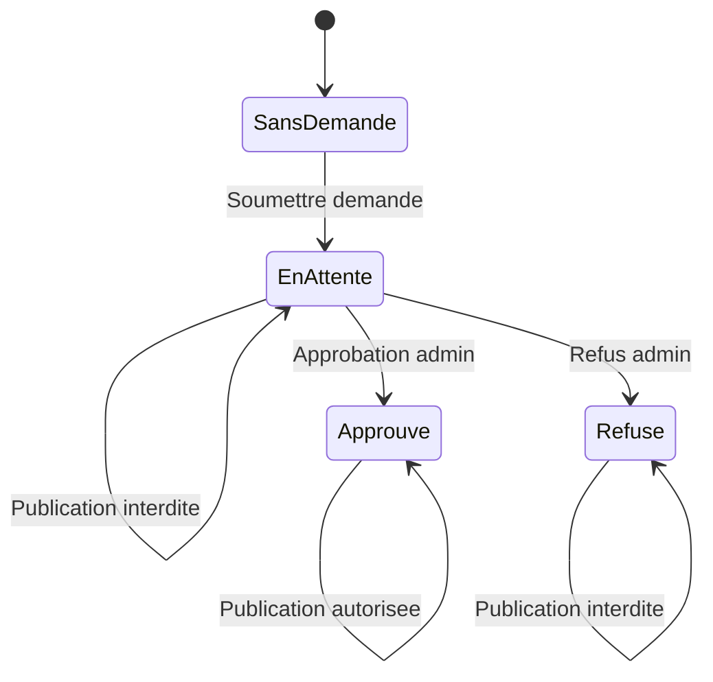
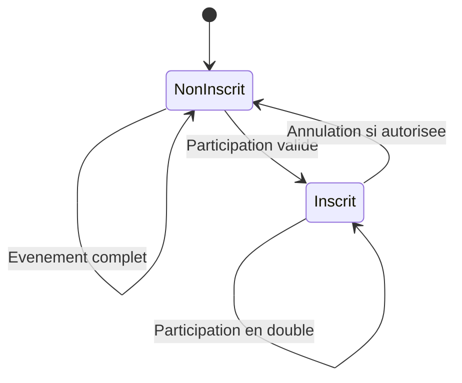
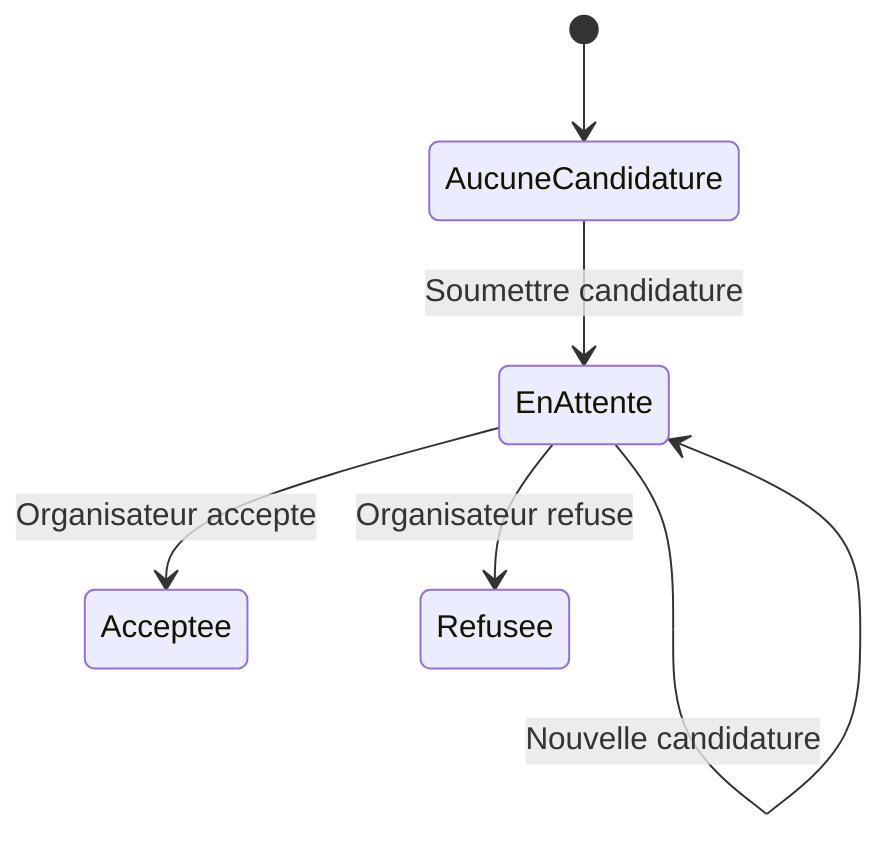
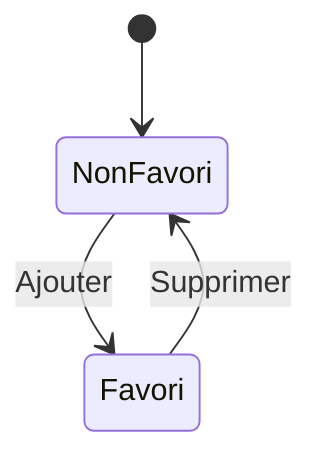

# State Transition Testing — CHNOWA FAMA

## 1. Objectif

Appliquer la technique des tests de transition d'état afin de vérifier les changements de statut et les comportements de CHNOWA FAMA après différentes actions utilisateur.

## 2. Principe ISTQB

Les tests de transition d'état constituent une technique de test boîte noire permettant de vérifier le comportement d'un système en fonction de son état actuel et des événements qui surviennent.

Une transition est définie par :

- Un état initial.
- Un événement déclencheur.
- Une condition éventuelle.
- Un état final.
- Une action ou un résultat attendu.

Les transitions valides et invalides doivent être vérifiées.

Les modèles présentés dans ce document sont des modèles candidats à confirmer avec les exigences et les fonctionnalités réellement implémentées.

## 3. Module Authentification

Exigences associées : RF04, RF05, RF06 et RF36.

Cas de test associés : TC04, TC05, TC06, TC09 et TC40.

### États

- Non authentifié.
- Authentifié.

### Diagramme de transition

### Table de transition

| ID | État initial | Action | État final attendu | Résultat attendu |
|---|---|---|---|---|
| TS01 | Non authentifié | Connexion valide | Authentifié | Accès autorisé |
| TS02 | Non authentifié | Mot de passe incorrect | Non authentifié | Connexion refusée |
| TS03 | Authentifié | Déconnexion | Non authentifié | Session locale terminée |
| TS04 | Non authentifié | Accès à une page protégée | Non authentifié | Accès refusé |
| TS05 | Authentifié | Expiration du token JWT | Non authentifié | Accès aux ressources protégées refusé |

Le comportement de l'interface lors de l'expiration du token doit être confirmé.

## 4. Module Organisateurs

Exigences associées : RF25, RF26, RF27, RF28, RF34 et RF35.

Cas de test associés : TC29, TC30, TC31, TC32, TC38 et TC39.

### États candidats

- Utilisateur sans demande.
- Demande en attente.
- Organisateur approuvé.
- Organisateur refusé, si ce statut existe.

### Diagramme de transition

### Table de transition

| ID | État initial | Action | État final attendu | Résultat attendu |
|---|---|---|---|---|
| TS06 | Sans demande | Soumettre une demande valide | En attente | Demande enregistrée |
| TS07 | En attente | Administrateur approuve | Approuvé | Statut modifié |
| TS08 | En attente | Administrateur refuse | Refusé | Statut modifié si cette action existe |
| TS09 | En attente | Tenter de publier | En attente | Publication refusée |
| TS10 | Approuvé | Créer un événement valide | Approuvé | Événement créé |
| TS11 | Refusé | Tenter de publier | Refusé | Publication refusée |
| TS12 | En attente | Approbation par un utilisateur simple | En attente | Accès refusé |

Les noms exacts des statuts et les transitions disponibles doivent être vérifiés dans le Backend et PostgreSQL.

## 5. Module Participation aux événements

Exigences associées : RF20, RF21, RF22 et RF24.

Cas de test associés : TC24, TC25, TC26 et TC28.

### États

- Non inscrit.
- Inscrit.

### Diagramme de transition

### Table de transition

| ID | État initial | Action | État final attendu | Résultat attendu |
|---|---|---|---|---|
| TS13 | Non inscrit | Participer à un événement disponible | Inscrit | Participation enregistrée |
| TS14 | Non inscrit | Participer à un événement complet | Non inscrit | Participation refusée |
| TS15 | Inscrit | Répéter la participation | Inscrit | Aucun doublon créé |
| TS16 | Inscrit | Annuler la participation | Non inscrit | Participation annulée si autorisée |

La capacité maximale et la possibilité d'annulation doivent être confirmées.

## 6. Module Candidatures

Exigences associées : RF23, RF24 et RF31.

Cas de test associés : TC27, TC28 et TC35.

### États candidats

- Aucune candidature.
- Candidature en attente.
- Candidature acceptée.
- Candidature refusée.

### Diagramme de transition

### Table de transition

| ID | État initial | Action | État final attendu | Résultat attendu |
|---|---|---|---|---|
| TS17 | Aucune candidature | Soumettre une candidature valide | En attente | Candidature enregistrée |
| TS18 | En attente | Organisateur accepte | Acceptée | Statut mis à jour |
| TS19 | En attente | Organisateur refuse | Refusée | Statut mis à jour |
| TS20 | En attente | Soumettre une candidature identique | En attente | Aucun doublon créé |
| TS21 | En attente | Modification par un utilisateur non autorisé | En attente | Accès refusé |

Ces scénarios sont applicables uniquement aux mécanismes de candidature réellement disponibles dans CHNOWA FAMA.

## 7. Module Favoris

Exigences associées : RF16, RF17, RF18 et RF19.

Cas de test associés : TC20, TC21, TC22 et TC23.

### États

- Événement non ajouté aux favoris.
- Événement ajouté aux favoris.

### Diagramme de transition

### Table de transition

| ID | État initial | Action | État final attendu | Résultat attendu |
|---|---|---|---|---|
| TS22 | Non favori | Ajouter aux favoris | Favori | Événement enregistré |
| TS23 | Favori | Supprimer des favoris | Non favori | Événement retiré |
| TS24 | Favori | Répéter une requête explicite d'ajout | Favori | Aucun doublon créé |

Si l'interface utilise un bouton de basculement, le second clic doit retirer le favori conformément au comportement prévu. Le scénario de doublon doit alors être testé au niveau API.

## 8. Méthodologie d'exécution

Pour chaque scénario :

1. Identifier l'état initial.
2. Préparer les données nécessaires.
3. Vérifier les préconditions.
4. Exécuter l'action déclenchant la transition.
5. Observer le nouvel état.
6. Vérifier si nécessaire la persistance dans PostgreSQL.
7. Comparer le résultat obtenu au résultat attendu.
8. Documenter le statut du test.
9. Signaler les anomalies éventuelles.

## 9. Couverture des transitions

La couverture des transitions permet de mesurer la proportion des transitions identifiées qui ont été exécutées pendant la campagne de test.

Couverture = (Nombre de transitions couvertes / Nombre total de transitions applicables identifiées) × 100.

Les transitions valides et invalides doivent être distinguées dans les résultats.

## 10. Synthèse

| Module | Nombre de scénarios candidats |
|---|---:|
| Authentification | 5 |
| Organisateurs | 7 |
| Participation | 4 |
| Candidatures | 5 |
| Favoris | 3 |
| Total | 24 |

## 11. Résultats d'exécution

Les scénarios TS01 à TS24 sont initialement au statut NOT RUN.

Les résultats seront documentés dans test-execution.md.

Les scénarios non applicables seront identifiés et justifiés.

Les scénarios communs avec les autres techniques ISTQB seront associés aux mêmes exécutions afin d'éviter les doublons dans le rapport final.

## 12. Conclusion

Les tests de transition d'état permettent de vérifier la cohérence des changements de statut dans CHNOWA FAMA.

Ils contribuent notamment à la validation de l'authentification, de l'approbation des organisateurs, des participations, des candidatures et de la gestion des favoris.